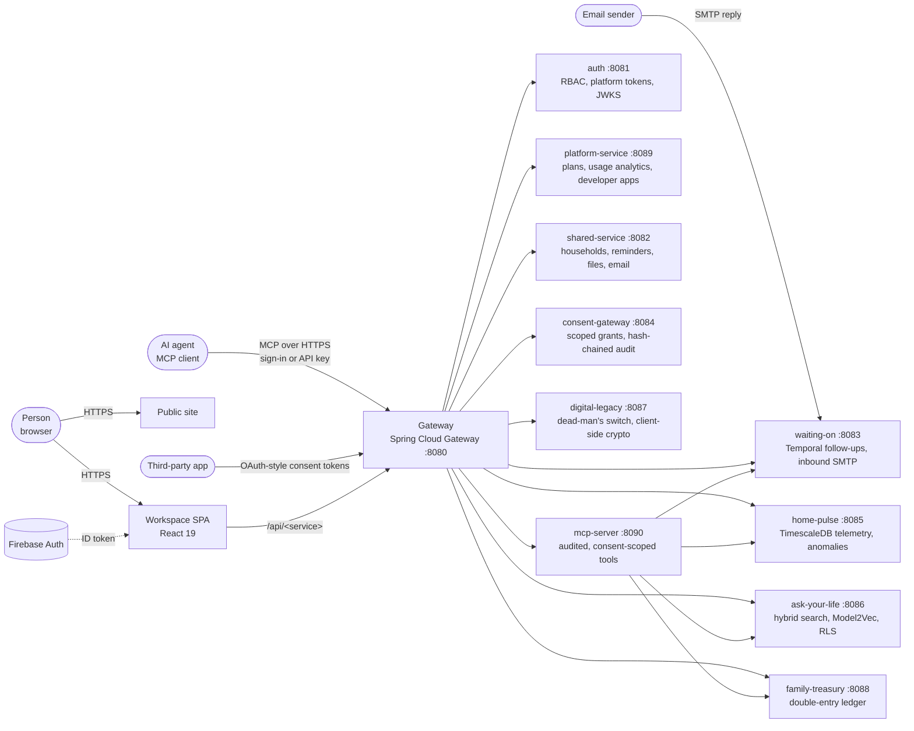
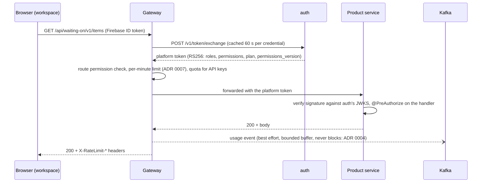
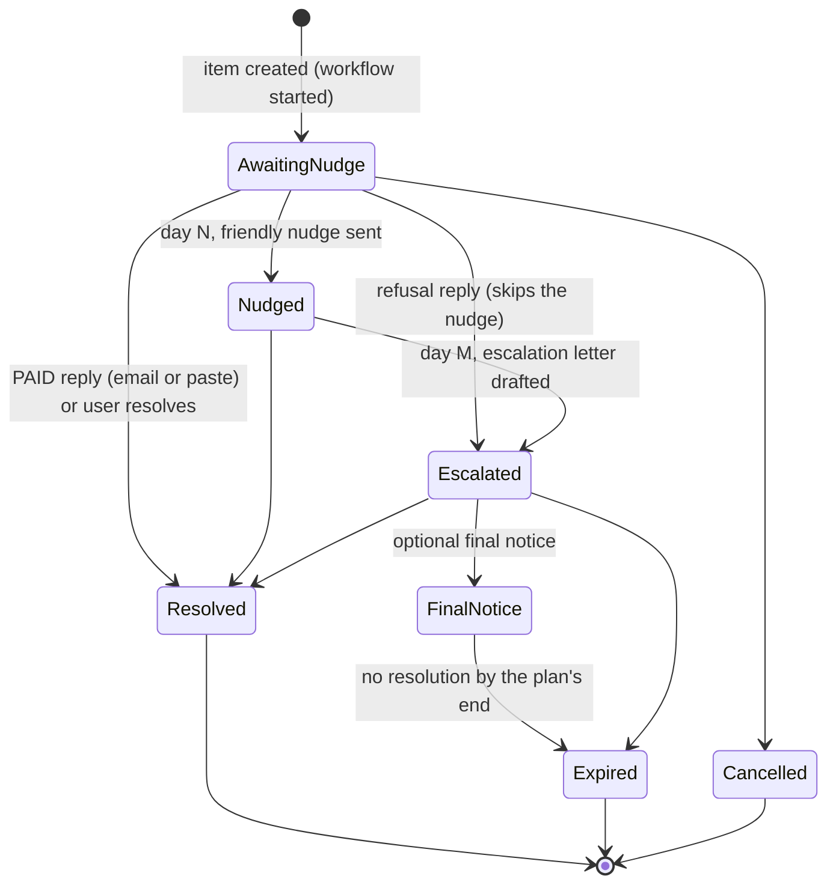
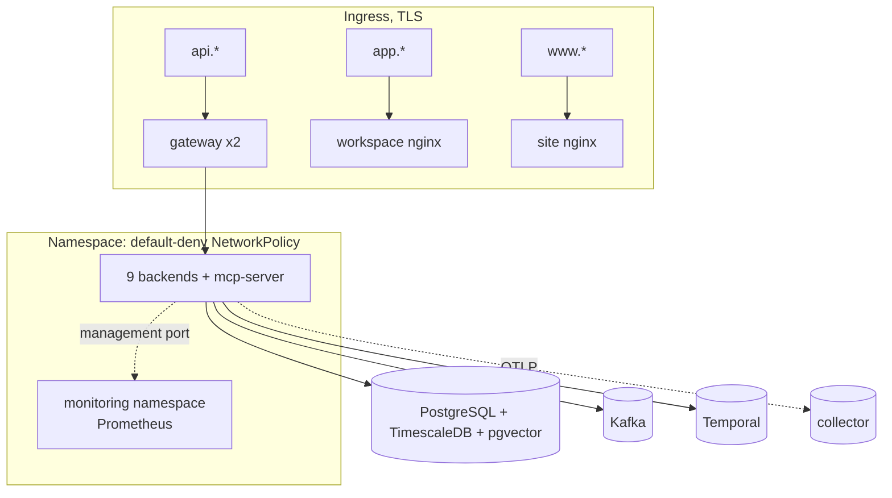

# Architecture

Diagrams are Mermaid, so GitHub renders them. Each one names the code that implements it. Decisions behind them are in
[`docs/adr/`](adr/README.md); how it is deployed is in [`docs/deploy.md`](deploy.md).

## 1. System context



All backends verify the platform token themselves; the gateway is the only public entrance (ADR 0001). One PostgreSQL
16 database holds a schema per service (TimescaleDB for home-pulse, pgvector for ask-your-life). Kafka carries usage
events; Temporal runs Waiting On's follow-ups.

## 2. A signed-in request



Code: `gateway/.../security/ExchangeFilter.java`, `gateway/.../ratelimit/RateLimitFilter.java`,
`libs/platform-security`, `auth/.../token/`.

## 3. Usage metering and analytics

```mermaid
flowchart LR
  gw[Gateway] -->|platform.usage.v1| kafka[(Kafka)]
  kafka --> consumer[platform-service consumer<br/>idempotent on event id]
  consumer --> hyper[(usage_events<br/>Timescale hypertable)]
  hyper --> agg[(continuous aggregates<br/>per minute, per day)]
  agg --> api[/owner analytics, self usage,<br/>quota lookups/]
  api -->|plans, quota (background, fail-open)| gw
```

## 4. A Waiting On follow-up



The workflow is Temporal code with durable timers (`waiting-on/.../workflow/FollowUpWorkflowImpl.java`). Replies arrive
by SMTP to a per-item address, by a provider webhook, or by paste; all three use one classification pipeline. If
Temporal loses a workflow, `FollowUpReconciler` restarts it at the item's real stage and original dates.

## 5. Deployment (Kubernetes)



Pods run as non-root on read-only filesystems with all capabilities dropped; actuator lives on a private management
port that only the monitoring namespace may reach (ADR 0005). Chart: `deploy/helm/my-trove`; single-host alternative:
`deploy/compose/compose.yaml`.
